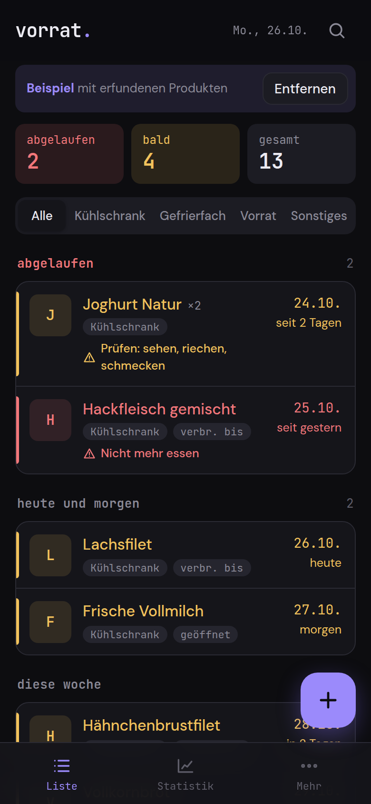
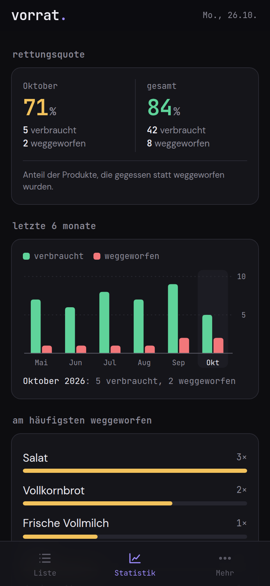
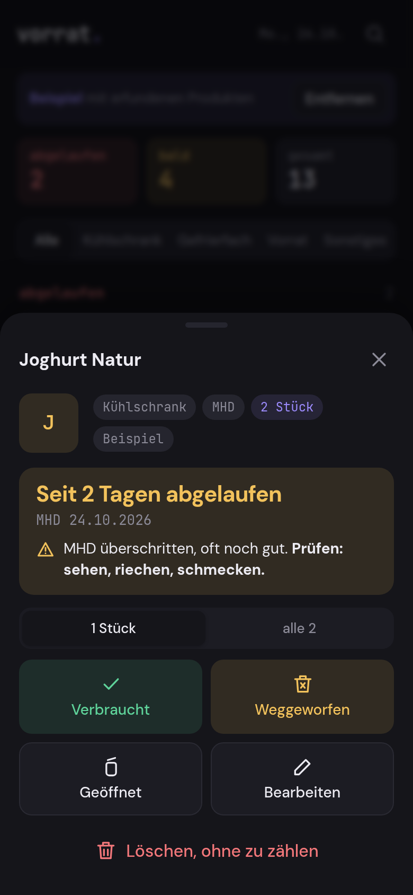

# vorrat.

**What in the fridge expires next?**

vorrat. is an expiry date tracker for your fridge, freezer and pantry. You add a product and its best-before date, and the app shows what to eat first and reminds you in time. It is a PWA that works offline, with no account and no server. Everything stays on your phone.

   

**Try it:** https://vorrat.gedachtgemacht.app (works in any phone browser, install via "Add to Home Screen")

The app interface is in German.

<p align="center">
  
  
  
</p>

## Why

Almost every household throws food away because nobody remembers what expires when. vorrat. makes that visible: add the product, add the date, done. The app shows what comes first and reminds you in time. No AI, no ads, no tracking.

## Features

- **Quick add**: scan a barcode or type a name, pick a location, set the date with quick picks (+3 days up to +1 year) or by typing digits (`251226` becomes 25.12.2026, `2512` becomes the next 25 December).
- **Best-before and use-by dates** are kept apart. An expired use-by date is marked red, **nicht mehr essen** ("do not eat anymore"). An expired best-before date is marked yellow, **prüfen: sehen, riechen, schmecken** ("check: look, smell, taste").
- **Barcode scanner** using the rear camera. It uses the built-in `BarcodeDetector` (Chrome on Android) and otherwise an embedded library (iPhone, Safari, Firefox). EAN-13, EAN-8, UPC-A, UPC-E, and the check digit is always verified. You can also pick a photo of the barcode or type the number.
- **Product memory**: a barcode or name you had before fills in name, location, date type and typical shelf life.
- **Opened on**: with a shelf life after opening (for example milk, 3 days), the earlier of the two dates applies automatically.
- **List** grouped into expired, today and tomorrow, this week, later. Filter by location, search, quantity, photo, note.
- **Used up or thrown away**, with undo. This feeds the **statistics**: share of food saved for the month and overall, bars for the last 6 months, the products you throw away most often.
- **Reminders**: a local notification when you open the app (at most once a day), and a calendar export (.ics) of all expiry dates in the next 60 days with an alarm one day before at 9 am.
- **Export**: stock and history as CSV (German Excel format), and a JSON backup including photos that you can import again.
- Light and dark theme, works offline after the first visit.

## Privacy

All data is stored in IndexedDB in the browser on your device. There is no server and no account.

The one exception, which you can switch off under **Mehr, Einstellungen** ("More, Settings"): when you scan an unknown barcode, vorrat. asks [Open Food Facts](https://world.openfoodfacts.org) for the product name. Only the barcode number is sent, no other data. Without a connection or after a timeout (4 seconds), you just type the name yourself.

## Install

1. Put the `vorrat/` folder on any static web host (your own server, GitHub Pages, Netlify). There is no build step and there are no dependencies.
2. Open the address in your phone browser.
3. In the browser menu choose **Add to Home Screen**. After that vorrat. starts like an app and works offline.

The camera and notifications only work over **HTTPS** (or `localhost`). On the iPhone, notifications only work when vorrat. is on the home screen. Without a camera you can pick a photo of the barcode or type the number.

Test locally:

```
cd vorrat
python3 -m http.server 8000
```

Then open `http://localhost:8000`.

## Tech

A single `index.html` with embedded fonts, styles and scripts, plus manifest, service worker and icons. No CDNs, no external runtime dependencies.

Barcode fallback: a subset of [ZXing for JS](https://github.com/zxing-js/library) (`@zxing/library` 0.23.0, only the EAN/UPC readers), bundled with esbuild and embedded directly, about 61 KB. License: Apache License 2.0, Copyright ZXing authors.

## License

GNU Affero General Public License v3.0 (AGPL-3.0), see `LICENSE`.

**Deutsch:** vorrat. ist eine MHD-App für Kühlschrank und Vorratsschrank, die Ablaufdaten im Blick behält, per Barcode scannt und gegen Lebensmittelverschwendung hilft, offline, ohne Konto, alles bleibt auf dem Handy.

---

**gedacht.gemacht.** Small, honest software. Everything stays on your device. · [More projects](https://github.com/gedachtgemacht)
